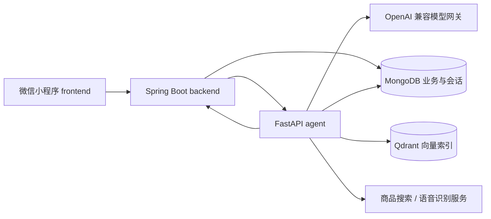
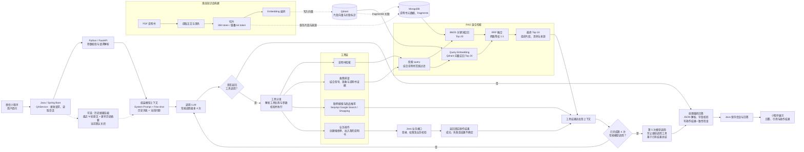

# Agent Appliance Assistant

家电说明书智能服务小程序

面向家电说明书查找、阅读、故障咨询和售后报修场景的微信原生小程序。项目由 **Python Agent、Java 业务后端、微信小程序前端** 三部分组成，提供说明书管理、AI 问答、工具调用及会话记忆实现。

本仓库是源码整理版：保留运行源码、测试、必要图标和本地 tokenizer，移除真实密钥、个人 AppID、个人电脑路径、日志文件、构建产物、数据库内容及评测原始回包。未携带原仓库 Git 历史。

## 三个独立模块

| 目录 | 模块 | 职责 | 技术 |
| --- | --- | --- | --- |
| `agent/` | AI Agent | 模型调用、混合检索、工具编排、摘要压缩、语音服务适配 | Python、FastAPI、OpenAI SDK、MongoDB、Qdrant、FastEmbed |
| `BE/` | 软件后端 | 小程序统一业务 API、说明书/用户/工单数据、会话归属与执行状态 | Java 17、Spring Boot 3.2.6、MongoDB、PDFBox |
| `FE/` | 软件前端 | 说明书检索与阅读、AI 会话、收藏、上传、报修、个人中心 | 微信原生小程序、JavaScript、WXML、WXSS |
| `docs/` | 项目文档 | 结构、功能、架构、启动、配置、接口、测试运行与整理说明 | Markdown |
| `scripts/` | 辅助脚本 | 合成演示数据导入、发布副本检查 | Python 标准库 / PyMongo |

## 功能入口

- 说明书：分类、关键词搜索、PDF/图片阅读、上传、收藏、批注与评论。

- AI：说明书问答、故障咨询、按意图调用五类工具，返回证据来源与页码。

- 服务：收藏说明书、经确认创建报修单、查看及取消工单、消息与设备管理。

- 会话：会话列表、标题修改与删除；实现按阈值批量压缩及重复请求控制。

功能实现和外部依赖的边界见 [功能说明](docs/FEATURES.md)。登录目前为 Demo 实现；会话记忆默认关闭，启用前需要配置双方参数并确认模型上下文容量。

## 开始使用

1. 按 [启动说明](docs/SETUP.md) 准备 Java 17、Python 3.11/3.12、MongoDB 和 Qdrant，或使用根目录 Docker Compose。
2. 根据 [配置说明](docs/CONFIGURATION.md) 填写自己的模型凭据、内部调用令牌与小程序 AppID。
3. 可导入 `data/demo-manuals.json` 的合成说明书，再建立向量索引。
4. 用微信开发者工具打开 `FE/`；本机开发后端地址为 `http://localhost:18083`。

模型配置保留历史环境变量名 `DEEPSEEK_*`，实际默认模型为 `qwen3.8-flash-next`，网关地址可配置。整理版没有模型密钥，付费模型不会在测试中自动调用。

## 文档导航

- [项目结构](docs/PROJECT_STRUCTURE.md)
- [功能说明与实现边界](docs/FEATURES.md)
- [Agent 架构与执行流程](docs/ARCHITECTURE.md)
- [环境与启动步骤](docs/SETUP.md)
- [配置字段与会话压缩](docs/CONFIGURATION.md)
- [接口概览](docs/API.md)
- [测试运行说明](docs/TESTING.md)
- [清理及隐私处理说明](docs/PUBLIC_EXPORT.md)
- [第三方资源说明](THIRD_PARTY_NOTICES.md)

本项目采用 [MIT 许可证](LICENSE)。第三方资源保留各自的许可证，详见 [第三方资源说明](THIRD_PARTY_NOTICES.md)。
