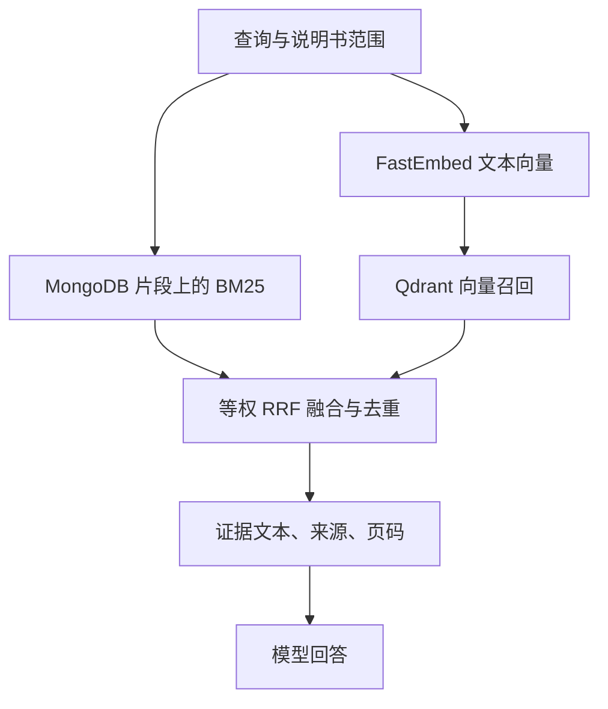

# Agent 与业务架构

## 请求链路

1. 小程序通过 `utils/request.js` 调用 Java 业务 API，并携带当前用户标识。
2. Java 校验请求、会话归属和说明书上下文，根据配置调用 Python Agent；业务上下文由服务端解析，模型不自由指定业务用户 ID。
3. Agent 组装 Prompt、工具 Schema 和上下文，调用 OpenAI 兼容 Chat Completions 接口。
4. 若模型请求工具，注册器校验工具名、JSON 参数及参数来源，再执行检索或通过 Java 发起业务写入。
5. 工具结果返回模型；循环达到上限时进入最终回答。最终结构不合法时允许一次仅格式修复调用，不在修复阶段再次执行工具。
6. Java 返回响应并保存会话/请求状态；前端只接受属于当前身份和视图的回包。

## 检索路径

说明书原文件、Java 文本提取生成的片段和 Qdrant 索引是三个不同层次。`agent/app/indexing.py` 从 MongoDB `fragments` 建立向量索引；首次 Embedding 可能下载模型。索引不是随每次业务上传自动完成，需按数据变更触发更新。

## 业务写入与失败状态

`argument_policy.py` 校验参数与对话证据；业务对象由后端解析。工具回执是回答执行结果的依据，模型文字本身不能证明操作完成。

| 状态 | 行为 |
| --- | --- |
| 未派发 / 参数拒绝 | 说明缺失或冲突，不表示业务已完成 |
| 明确成功 | 保留实际成功回执，不重复执行已观察到的写入 |
| 明确失败 | 返回可理解的失败信息 |
| 结果未知 | 不自动重新提交写入，优先核实请求状态 |

Java 请求账本与会话租约用于同一请求的重复提交、并发控制和故障恢复；不能据此宣称任意新请求下业务全局“恰好执行一次”。

## 阈值摘要

触发计数针对摘要与未覆盖历史文本，实际请求还包含系统 Prompt、工具定义、证据和当前问题。1500 是压缩触发阈值；24000 等配置为模型输入预算，两者用途不同。

本地计数器固定使用随仓库保留的 DeepSeek 文本 tokenizer，校验 SHA-256 后加载。切到 Qwen 后它仍属于预算估算，`exactCount=false`；真实账单应以 API usage 为准。

压缩仅处理更早历史，最近五个完整轮次保留原文。默认摘要 600，支持 1000；旧摘要和新增旧轮次一起压缩。摘要失败时保留完整材料，输入预算不足时显式报错或按既有预算策略处理，不能静默假定摘要成功。

## 外部系统边界

- 模型网关需兼容 Chat Completions 与工具调用；当前模型名和地址可自行替换。
- SerpAPI 与腾讯 ASR 为可选能力，未配置时不能视为可用。
- Java 回退路径保留，但其检索、模型配置与 Python Agent 路径不同。
- 小程序 Demo 登录未接入真实微信身份交换与完整服务端鉴权；正式部署需要补齐认证，不能直接把 `X-User-Id` 视为可信身份。
